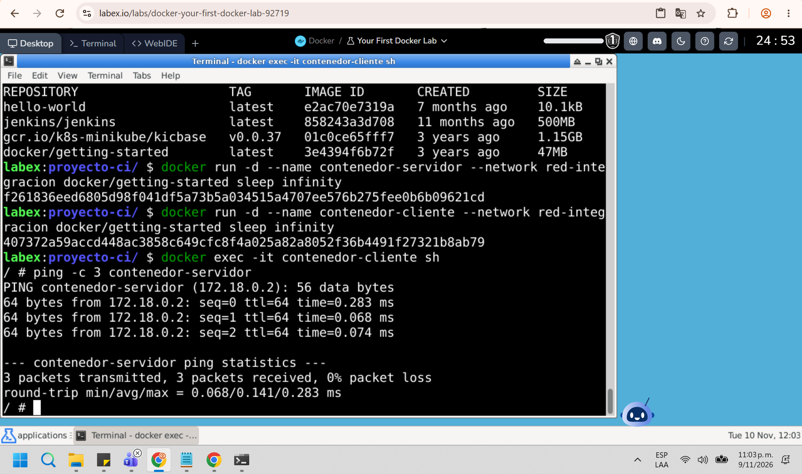

# Proyecto Integración Continua - Entrega 1

## Objetivo
Implementar dos contenedores Docker comunicados entre sí para la primera entrega del proyecto.

## Arquitectura
Se configuró una red interna de Docker llamada "red-integracion" y se crearon dos contenedores basados en la imagen `docker/getting-started`:
1. **contenedor-cliente**: Inicia la comunicación.
2. **contenedor-servidor**: Recibe la comunicación.

Ambos están conectados a la misma red, lo que permite que se resuelvan por nombre (DNS interno de Docker) sin necesidad de exponer puertos al exterior.

## Demostración de comunicación
Se realizó la validación del entorno ejecutando un ping desde el contenedor cliente hacia el contenedor servidor a través de la red interna de Docker.

A continuación, se adjunta la evidencia de la ejecución exitosa:

*(Nota: El archivo 'docker-compose.yml' incluido en este repositorio contiene la configuración equivalente para desplegar estos mismos contenedores en cualquier entorno con Docker Compose instalado).*
