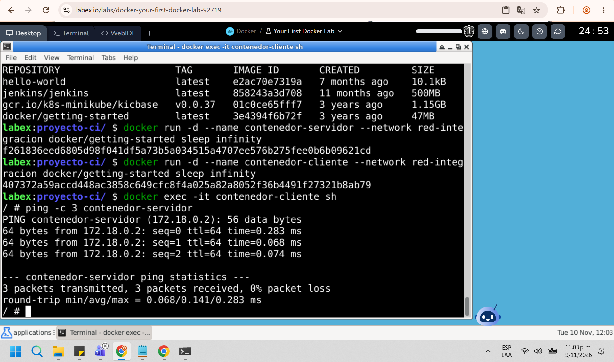

# Proyecto Integración Continua - Laboratorio Dental

## Objetivo del Proyecto
Este repositorio contiene el proyecto de una aplicación móvil desarrollada en **Ionic y Angular**. El objetivo es implementar y demostrar prácticas de Integración Continua (CI) a lo largo del semestre, evidenciando un desarrollo iterativo e incremental.

## Estado del Proyecto (Evolución)

### Fase 1 (Entrega 1): Configuración Base e Infraestructura Docker
En esta primera etapa, se ha establecido la base del proyecto. Se subieron los archivos de configuración de dependencias (como 'package.json' y 'angular.json') para inicializar el entorno de desarrollo.

Adicionalmente, se implementó la infraestructura base de contenedores:
*   **Red Docker:** Se configuró una red interna llamada 'red-integracion'.
*   **Contenedores:** Se crearon dos contenedores ('contenedor-cliente' y 'contenedor-servidor') para validar la comunicación y resolución de nombres (DNS interno de Docker).

#### Evidencia de Ejecución (Docker)
A continuación, se adjunta la evidencia del ping exitoso entre los contenedores, comprobando la correcta comunicación:

## Fase 2 (Entrega 2): Implementación de Jenkins como Gestor de Operaciones
En esta etapa se incorporó **Jenkins** ('jenkins/jenkins:latest') como gestor de operaciones de integración continua sobre la red interna 'red-integracion' en el entorno de laboratorio LabEx, manteniendo la vinculación con este repositorio (rama 'main') para la aplicación del laboratorio dental en Ionic/Angular.
- **Job configurado:** 'Proyecto-Laboratorio-Dental-CI' (tipo *Freestyle*), exponiendo el puerto '8080' para la interfaz web y el '50000' para agentes/nodos.
- **Ejecución y validación:** Build '#1' completado con estado 'Finished: SUCCESS', verificando la estructura base, simulando la compilación (*build*) y comprobando pruebas unitarias.
- **Avance incremental:** Consolidación de la documentación y archivos base del proyecto móvil manteniendo margen para la siguiente entrega.
